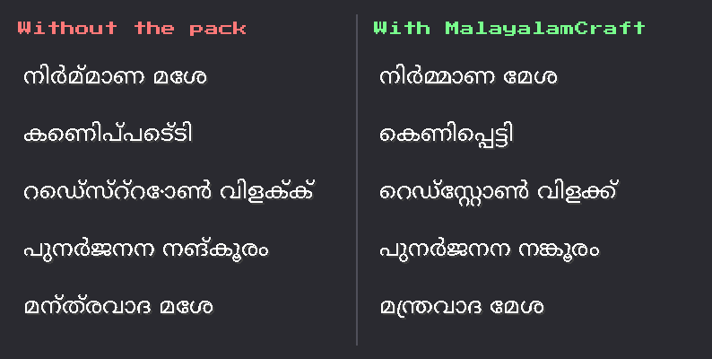
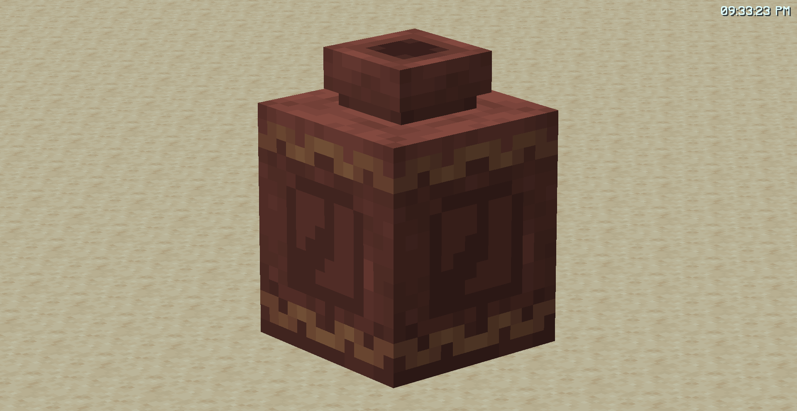
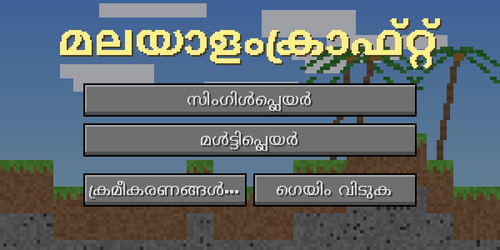
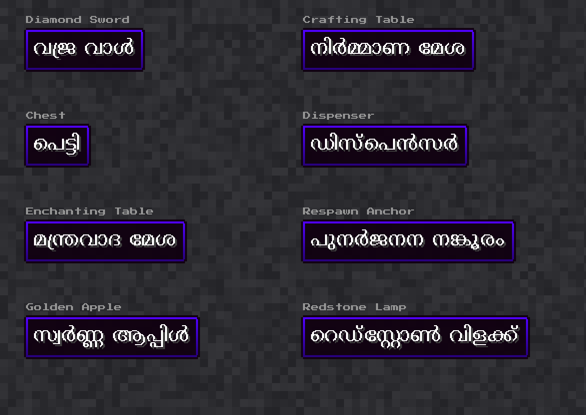

<p align="center">
  
</p>

<p align="center">
  <b>Play Minecraft in Malayalam, with letters that join the way they should.</b><br>
  മൈൻക്രാഫ്റ്റ് ഇനി മലയാളത്തിൽ
</p>

<p align="center">
  <a href="https://github.com/CreativeBuilds1236/MalayalamCraft/releases/latest"></a>
  
  
</p>

---

MalayalamCraft is a resource pack that puts Minecraft Java Edition into Malayalam. Blocks, items, mobs, biomes, menus, settings, advancements, death messages, subtitles, potions, enchantments and statistics are all translated. That's 6,542 of the 8,559 lines in Minecraft 26.3.

Malayalam usually comes out broken in Minecraft. Conjuncts (കൂട്ടക്ഷരങ്ങൾ) fall apart and vowel signs like െ and േ land on the wrong side. This pack fixes that.

<p align="center">
  
</p>

## Screenshots

<p align="center">
  <br>
  <sub>The decorated pot from the pack icon, in game</sub>
</p>

<p align="center">
  <br>
  <sub>Main menu</sub>
</p>

<p align="center">
  <br>
  <sub>Item names, drawn from the pack's own font files</sub>
</p>

## Install

1. Download **MalayalamCraft.zip** from the [latest release](https://github.com/CreativeBuilds1236/MalayalamCraft/releases/latest).
2. Put the zip (don't unzip it) into your `.minecraft/resourcepacks` folder. In game you can open it from **Options → Resource Packs → Open Pack Folder**.
3. Turn on **MalayalamCraft** in the Resource Packs screen.
4. Keep the game language on **English (US)**. The pack replaces the English text with Malayalam.

Works with Minecraft Java Edition 1.20 up to 26.3.

## How it works

Minecraft draws text one character at a time and never joins letters together. That's fine for English, but Malayalam needs letters to combine. A different font file can't fix this, because Minecraft never does the joining step.

So the pack does the joining before Minecraft ever sees the text:

1. Every Malayalam word is split into syllables using HarfBuzz, the same text engine web browsers use.
2. Each syllable is drawn once, correctly, using the Noto Sans Malayalam font.
3. Each drawn syllable gets its own spare character code, and a bitmap font tells Minecraft which picture to show for it.
4. The game's text is rewritten to use those codes. English words, `%s` placeholders and `§` colour codes stay as they are.

That's why the files inside `pack/assets/minecraft/lang` look like gibberish if you open them. Don't edit them by hand.

## Translation style

Everyday things use real Malayalam words: വാൾ (sword), പെട്ടി (chest), ചൂള (furnace), കണ്ടൽ (mangrove), മുള (bamboo). Names that only exist in Minecraft are written in Malayalam script, like ക്രീപ്പർ, നെതർ and റെഡ്സ്റ്റോൺ.

Spotted a wrong or awkward word? Please [open an issue](https://github.com/CreativeBuilds1236/MalayalamCraft/issues) with the English text and what it should say.

## Known limits

- Text typed in game (chat, signs, books, anvil names) and text sent by servers or mods can't be joined this way. It shows Minecraft's normal, unjoined Malayalam.
- Some rarely seen text is still in English: chat command messages, Realms screens and debug messages.
- Key names, Roman numerals, song titles and painting authors are left in English on purpose.

## Repository layout

```
pack/      the resource pack, unzipped (this is what goes in the release zip)
images/    banner and screenshots used in this README
```

To publish a new version, change the number in `VERSION` and push. A GitHub Action zips `pack/` and creates the release.

## Credits

- Pack by **Rajesh Divakaran** ([@CreativeBuilds1236](https://github.com/CreativeBuilds1236))
- Malayalam glyphs drawn from [Noto Sans Malayalam](https://github.com/notofonts/malayalam), © The Noto Project Authors, under the SIL Open Font License 1.1 (see `pack/FONT-LICENSE.txt`)

MalayalamCraft is a fan-made resource pack. It is not an official Minecraft product and is not approved by or associated with Mojang or Microsoft.
